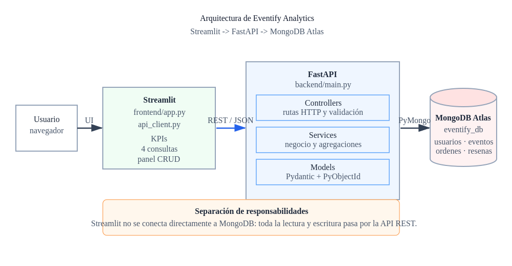

# Informe técnico: Eventify Analytics

**Curso:** BDY0101
**Evaluación:** E3 2026-2
**Integrantes:** [completar]
**Fecha:** [completar]

---

## 1. Contexto y continuidad del proyecto

Eventify es una plataforma de venta de entradas para conciertos, festivales, obras de teatro y conferencias. En la Evaluación 2 se diseñó el modelo documental en MongoDB, se cargaron datos de prueba y se construyeron cuatro consultas de agregación. En la Evaluación 3 se integra ese trabajo en una aplicación operativa compuesta por:

- una API REST desarrollada con FastAPI;
- un módulo de visualización y analítica desarrollado con Streamlit;
- una base de datos MongoDB que almacena las colecciones `usuarios`, `eventos`, `ordenes_compra` y `resenas_evaluaciones`.

El objetivo es exponer los datos del negocio mediante endpoints HTTP, resolver las consultas complejas de la E2 y entregar un dashboard que consuma exclusivamente la API.

## 2. Objetivos

1. Implementar una API REST modular bajo el patrón Controller - Service - Model.
2. Exponer operaciones CRUD para las cuatro colecciones del negocio.
3. Publicar las cuatro consultas analíticas de la Evaluación 2 como endpoints.
4. Calcular y exponer al menos tres KPIs de negocio.
5. Construir un dashboard interactivo en Streamlit que consuma solo la API.
6. Documentar la instalación, ejecución, endpoints, visualizaciones y decisiones de diseño.

## 3. Arquitectura

La aplicación separa la visualización del acceso a datos:

```text
Streamlit  ->  FastAPI  ->  MongoDB Atlas
```

- **Streamlit** utiliza `requests` contra `http://127.0.0.1:8000/api/v1`. No importa `pymongo` ni conoce la cadena de conexión.
- **FastAPI** valida las solicitudes con Pydantic, aplica reglas de negocio en la capa de servicios y ejecuta las agregaciones en MongoDB.
- **MongoDB** almacena los documentos y aplica validadores `$jsonSchema` e índices definidos en la E2.



El diagrama también está disponible en formato vectorial como `arquitectura.svg`.

### Capas

| Capa | Ubicación | Responsabilidad |
|---|---|---|
| Controladores | `backend/controllers/` | Rutas, parámetros HTTP, códigos de estado |
| Servicios | `backend/services/` | Reglas de negocio, validaciones y pipelines |
| Modelos | `backend/models/` | Esquemas Pydantic de entrada y salida |
| Base de datos | `backend/database.py` | Cliente PyMongo y selección de base |
| Configuración | `backend/config.py` | Variables de entorno con `pydantic-settings` |
| Utilidades | `backend/utils/` | Serialización, ObjectId, excepciones |

## 4. Modelo de datos

### 4.1 Colecciones

| Colección | Propósito | Relaciones |
|---|---|---|
| `usuarios` | Clientes y administradores | Referenciada por órdenes y reseñas |
| `eventos` | Conciertos, festivales, obras y conferencias | Referenciada por órdenes y reseñas; contiene `recinto` y `tickets_disponibles` embebidos |
| `ordenes_compra` | Compras realizadas por usuarios | `usuario_id` y `evento_id` son ObjectId; los ítems están embebidos |
| `resenas_evaluaciones` | Evaluaciones de eventos | `usuario_id` y `evento_id` son ObjectId; una reseña por usuario y evento |

### 4.2 Decisiones de modelado

- `recinto` se embebe en `eventos` porque se lee junto con el evento y tiene cardinalidad 1 a 1.
- `tickets_disponibles` se embebe porque es un arreglo acotado de objetos que se consulta junto con el evento.
- Los ítems de una orden se embeben porque pertenecen a la orden y no se comparten entre documentos.
- `usuario_id` y `evento_id` se referencian porque usuarios y eventos existen por sí mismos y participan en muchas órdenes y reseñas.

### 4.3 Validación e índices

Los validadores `$jsonSchema` exigen, entre otros:

- email con formato válido y único;
- `tipo_usuario` restringido a `cliente` o `administrador`;
- `categoria` restringida a `concierto`, `festival`, `obra de teatro` o `conferencia`;
- `puntuacion` entre 1 y 5;
- cada ticket con `tipo`, `precio`, `stock_inicial` y `stock_disponible`;
- cada orden con `usuario_id`, `evento_id`, `items`, `total`, `fecha_compra`, `estado` y `confirmado`.

Índices relevantes:

- `usuarios.email` único;
- `eventos.codigo` único;
- `eventos` por `recinto.ciudad` y `fecha_evento`;
- `ordenes_compra` por `usuario_id` y `evento_id`;
- `resenas_evaluaciones` único por `usuario_id` y `evento_id`.

## 5. Backend

### 5.1 Configuración y conexión

`backend/config.py` define `Settings` con `MONGO_URI`, `DATABASE_NAME` y `CORS_ORIGINS`. `backend/database.py` crea el cliente PyMongo y selecciona la base `eventify_db`.

El archivo `.env` no se versiona. `.env.example` documenta las variables necesarias.

### 5.2 Modelos Pydantic

- `models/usuario.py`: datos personales, tipo de usuario, fechas, VIP y estado.
- `models/evento.py`: evento, `Recinto` y `Ticket` embebidos.
- `models/orden.py`: orden e ítems con precios y cantidades.
- `models/resena.py`: reseña con puntuación entre 1 y 5.
- `models/analytics.py`: respuestas de consultas y KPIs.
- `models/common.py`: tipo `PyObjectId` que valida y serializa ObjectId.

Los modelos de salida normalizan `_id` como `id` y los ObjectId se transforman a texto mediante `backend/utils/serializer.py`.

### 5.3 CRUD

Cada colección dispone de:

- `GET` de listado con filtros;
- `GET` por identificador;
- `POST` de creación;
- `PUT` de reemplazo;
- `DELETE` de eliminación.

Reglas relevantes:

- `usuarios`: email único; no se elimina un usuario con órdenes o reseñas asociadas.
- `eventos`: código único; no se elimina un evento con órdenes o reseñas asociadas.
- `ordenes_compra`: se valida que el usuario y el evento existan; los precios y subtotales se recalculan con los valores del evento; si la orden está confirmada se descuenta stock y al eliminarla o cambiarla se repone.
- `resenas_evaluaciones`: se valida la existencia de usuario y evento; el índice único impide dos reseñas del mismo usuario al mismo evento.

### 5.4 Manejo de errores

| Situación | Código |
|---|---|
| Recurso inexistente | 404 |
| Duplicado o conflicto de referencia | 409 |
| Datos inválidos u ObjectId mal formado | 422 |
| Error de conexión con MongoDB | 503 |

Los manejadores se registran en `backend/main.py`.

### 5.5 CORS

La API permite los orígenes configurados en `CORS_ORIGINS`, por defecto `http://localhost:8501` y `http://127.0.0.1:8501`, necesarios para que Streamlit consuma la API desde el navegador.

## 6. Consultas analíticas

### 6.1 Consulta 1: compras por usuario y ciudad

**Pregunta:** ¿qué compró un usuario y cuánto gastó, desglosado por ciudad?

**Pipeline:**

1. `$match` por `usuario_id` y estado `confirmada`.
2. `$lookup` hacia `eventos` por `evento_id`.
3. `$unwind` del evento.
4. `$match` opcional por `detalle_evento.recinto.ciudad`.
5. `$unwind` de `items`.
6. `$group` por ciudad, sumando subtotales y cantidades, y acumulando el detalle de compras.
7. `$project` y `$sort` por gasto.

**Resultado:** usuario, lista de ciudades con gasto total, cantidad de tickets y detalle de compras.

### 6.2 Consulta 2: ventas por evento

**Pregunta:** ¿cuánto recaudó cada evento, cuántos tickets vendió y qué porcentaje de ocupación alcanzó?

**Pipeline:**

1. `$match` de órdenes confirmadas.
2. `$unwind` de ítems.
3. `$group` por evento, sumando subtotales y cantidades.
4. `$lookup` hacia `eventos`.
5. `$unwind` del evento.
6. `$addFields` para calcular el stock inicial total con `$sum` sobre `tickets_disponibles.stock_inicial`.
7. `$addFields` para calcular el porcentaje de venta con `$cond` y `$divide`.
8. `$project` con la etiqueta `"Exitoso"` si la ocupación es mayor o igual a 70%, o `"Por Mejorar"` en caso contrario.

**Resultado:** evento, ciudad, recaudación, tickets vendidos, stock inicial, porcentaje y clasificación.

### 6.3 Consulta 3: eventos futuros con tickets bajo un precio

**Pregunta:** ¿qué eventos futuros en una ciudad tienen tickets disponibles bajo un precio máximo?

**Pipeline:**

1. `$match` por `activo`, `fecha_evento` mayor que la fecha actual, ciudad opcional y `$elemMatch` sobre precio y stock.
2. `$project` con `$filter` para devolver solo los tickets que cumplen el precio y tienen stock.
3. `$sort` por fecha y `$limit`.

**Resultado:** eventos futuros con el subconjunto de tickets que cumplen las condiciones.

### 6.4 Consulta 4: riesgo de agotamiento de stock

**Pregunta:** ¿qué eventos futuros tienen tickets con stock bajo y podrían agotarse?

**Pipeline:**

1. `$match` de eventos activos futuros.
2. `$addFields` con `$map` para analizar cada ticket y marcar `bajo_stock`.
3. `$addFields` para calcular `stock_total` con `$sum` y `hay_bajo_stock` con `$in`.
4. `$addFields` con `$cond` para clasificar el estado del stock.
5. `$project` y `$sort` por stock total.

**Resultado:** evento, ciudad, fecha, stock total, estado y detalle de tickets analizados.

## 7. KPIs de negocio

### 7.1 Tasa de ocupación global

```text
tasa_ocupacion = tickets_vendidos_eventos_activos / stock_inicial_eventos_activos * 100
```

Se calcula con dos agregaciones: una sobre órdenes confirmadas para sumar cantidades vendidas y otra sobre eventos activos para sumar el stock inicial. Mide la conversión del inventario disponible.

### 7.2 Ticket promedio por orden

```text
ticket_promedio = recaudacion_total_confirmada / cantidad_ordenes_confirmadas
```

Resume el valor medio de cada compra. Se complementa con la recaudación total, que se muestra como tarjeta adicional en el dashboard.

### 7.3 Satisfacción promedio

```text
satisfaccion_promedio = promedio(puntuacion) en resenas_evaluaciones
```

Resume la percepción de los asistentes. Puede cruzarse con la clasificación de eventos exitosos para analizar la relación entre calidad percibida y desempeño comercial.

## 8. Frontend

`frontend/app.py` se organiza en tres secciones accesibles desde la barra lateral.

### 8.1 Indicadores

Cuatro tarjetas `st.metric`:

- recaudación total;
- tasa de ocupación;
- ticket promedio por orden;
- satisfacción promedio.

Además, una tabla con valores de apoyo: órdenes confirmadas, tickets vendidos, stock inicial, eventos activos, eventos exitosos y porcentaje de eventos exitosos.

### 8.2 Consultas analíticas

Cuatro pestañas con Plotly Express:

1. **Compras por usuario:** selector de usuario, filtro opcional por ciudad, tarjeta de gasto total, gráfico de barras y detalle por ciudad.
2. **Ventas por evento:** gráfico de barras de recaudación coloreado por clasificación, gráfico de dispersión de ocupación versus recaudación y tabla.
3. **Eventos disponibles:** filtros de ciudad, precio máximo y cantidad, tabla plana de tickets y gráfico de barras agrupado.
4. **Riesgo de stock:** umbral configurable, gráfico de barras por estado, tabla resumen y detalle expandible por evento.

### 8.3 Administración

Cuatro pestañas, una por colección. Cada una incluye:

- tabla `st.dataframe` con los registros actuales;
- formulario `st.form` para crear;
- formulario de edición con valores precargados;
- formulario de eliminación con confirmación.

Los formularios de eventos permiten editar el recinto y los tickets embebidos con `st.data_editor`. Los formularios de órdenes recalculan precios y subtotales a partir del evento seleccionado.

Todas las operaciones usan `frontend/api_client.py`. No existe conexión directa a MongoDB desde el frontend.

## 9. Instalación y ejecución

```bash
python3 -m venv .venv
source .venv/bin/activate
pip install -r requirements.txt
cp .env.example .env
# completar MONGO_URI en .env
uvicorn backend.main:app --reload --reload-dir backend
```

En otra terminal:

```bash
source .venv/bin/activate
streamlit run frontend/app.py
```

Documentación interactiva: `http://127.0.0.1:8000/docs`.

## 10. Catálogo de endpoints

| Método | Ruta | Descripción |
|---|---|---|
| GET | `/` | Mensaje de bienvenida |
| GET | `/api/v1/health` | Estado de la API |
| GET/POST | `/api/v1/usuarios` | Listar o crear usuarios |
| GET/PUT/DELETE | `/api/v1/usuarios/{id}` | Obtener, actualizar o eliminar usuario |
| GET/POST | `/api/v1/eventos` | Listar o crear eventos |
| GET/PUT/DELETE | `/api/v1/eventos/{id}` | Obtener, actualizar o eliminar evento |
| GET/POST | `/api/v1/ordenes` | Listar o crear órdenes |
| GET/PUT/DELETE | `/api/v1/ordenes/{id}` | Obtener, actualizar o eliminar orden |
| GET/POST | `/api/v1/resenas` | Listar o crear reseñas |
| GET/PUT/DELETE | `/api/v1/resenas/{id}` | Obtener, actualizar o eliminar reseña |
| GET | `/api/v1/consultas/compras-por-usuario` | Consulta 1 |
| GET | `/api/v1/consultas/ventas-por-evento` | Consulta 2 |
| GET | `/api/v1/consultas/eventos-disponibles` | Consulta 3 |
| GET | `/api/v1/consultas/riesgo-stock` | Consulta 4 |
| GET | `/api/v1/kpis` | KPIs de negocio |

## 11. Validación

Pruebas recomendadas antes de la entrega:

1. `python -m compileall backend frontend` para verificar sintaxis.
2. Levantar la API y abrir `/docs` para comprobar todos los endpoints.
3. Ejecutar las cuatro consultas y comparar sus resultados con los scripts de la E2.
4. Verificar que `/api/v1/kpis` devuelve valores coherentes.
5. Crear, editar y eliminar un usuario y un evento de prueba desde el dashboard.
6. Confirmar que una orden confirmada descuenta stock y que al eliminarla se repone.
7. Confirmar que Streamlit funciona con la API detenida mostrando un error controlado.

## 12. Conclusiones y limitaciones

La solución cumple con la separación por capas, expone las cuatro consultas de la E2 y agrega un dashboard operativo con KPIs y CRUD. El uso de Pydantic y de los validadores de MongoDB reduce la probabilidad de datos inválidos.

Limitaciones conocidas:

- El ajuste de stock de órdenes se realiza con actualizaciones controladas, pero no con transacciones multi-documento; en un entorno de alta concurrencia sería recomendable usar transacciones de MongoDB.
- La autenticación y autorización de la API no forman parte del alcance de la evaluación.
- Las fechas se almacenan en UTC y el dashboard no aplica conversión de zona horaria.

## 13. Anexo: ejemplos de uso

```bash
# KPIs
curl http://127.0.0.1:8000/api/v1/kpis

# Consulta 1 por email
curl "http://127.0.0.1:8000/api/v1/consultas/compras-por-usuario?email=juanin@eventify.cl&ciudad=Santiago"

# Consulta 2
curl "http://127.0.0.1:8000/api/v1/consultas/ventas-por-evento?limite=10"

# Consulta 3
curl "http://127.0.0.1:8000/api/v1/consultas/eventos-disponibles?ciudad=Santiago&precio_max=15000"

# Consulta 4
curl "http://127.0.0.1:8000/api/v1/consultas/riesgo-stock?umbral=200"

# Crear usuario
curl -X POST http://127.0.0.1:8000/api/v1/usuarios \
  -H "Content-Type: application/json" \
  -d '{"nombre":"Usuario Demo","email":"demo@eventify.cl","tipo_usuario":"cliente","fecha_nacimiento":"1995-01-01T00:00:00","fecha_registro":"2026-11-12T00:00:00","es_vip":false,"activo":true}'
```
