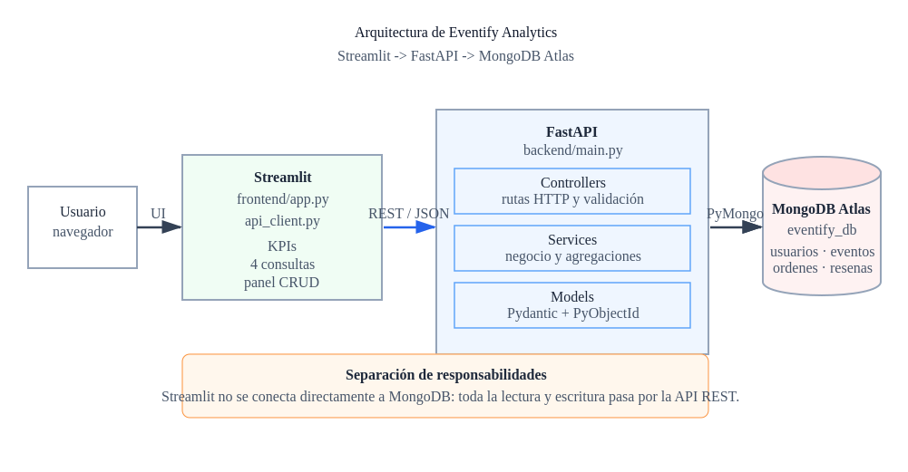
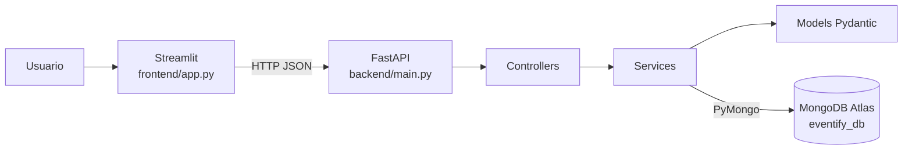

# Presentación y defensa oral: Eventify Analytics

Duración objetivo: **10 minutos**.
Formato sugerido: 9 a 12 diapositivas y demostración en vivo.

## Diapositiva 1: portada

- Título: **Eventify Analytics**
- Subtítulo: API REST + Dashboard para la gestión y analítica de eventos
- Curso: BDY0101
- Integrantes: [completar]
- Fecha: [completar]

## Diapositiva 2: contexto y continuidad

- En la E2 se diseñó el modelo documental y las cuatro consultas de agregación.
- En la E3 se integra todo en una aplicación operativa.
- Problema: los datos del negocio estaban en MongoDB, pero no había una interfaz para operarlos ni visualizarlos.
- Solución: API REST con FastAPI + dashboard con Streamlit.

## Diapositiva 3: arquitectura

Incluir el diagrama `arquitectura.png` (también disponible como `arquitectura.svg`):

Mensajes clave:

- Streamlit no se conecta a MongoDB.
- Toda la lógica y las agregaciones viven en la API.
- La API puede ser consumida por otra herramienta de BI.

## Diapositiva 4: patrón por capas

- **Controller:** rutas, parámetros, códigos HTTP.
- **Service:** reglas de negocio y pipelines.
- **Model:** validación Pydantic de entrada y salida.
- **Database:** cliente PyMongo.
- **Config:** variables de entorno.

Mostrar el árbol de carpetas resumido.

## Diapositiva 5: modelo de datos

- `usuarios`: clientes y administradores.
- `eventos`: recinto y tickets embebidos.
- `ordenes_compra`: referencias a usuario y evento, ítems embebidos.
- `resenas_evaluaciones`: una reseña por usuario y evento.

Destacar:

- embebido: `recinto`, `tickets_disponibles`, `items`;
- referenciado: `usuario_id`, `evento_id`;
- validadores `$jsonSchema` e índices únicos.

## Diapositiva 6: API REST

Tabla resumida:

| Recurso | Operaciones |
|---|---|
| Usuarios | GET, POST, PUT, DELETE |
| Eventos | GET, POST, PUT, DELETE |
| Órdenes | GET, POST, PUT, DELETE |
| Reseñas | GET, POST, PUT, DELETE |
| Analítica | 4 consultas + KPIs |

Mencionar:

- documentación automática en `/docs`;
- manejo de errores 404, 409, 422 y 503;
- ajuste de stock en órdenes.

## Diapositiva 7: las cuatro consultas

1. Compras por usuario y ciudad: `$lookup` + `$unwind` + `$group`.
2. Ventas por evento: recaudación, ocupación y clasificación.
3. Eventos futuros bajo un precio: `$elemMatch` + `$filter`.
4. Riesgo de stock: `$map` + `$addFields` + `$cond` + `$in`.

Para cada una indicar: pregunta de negocio, colecciones usadas y resultado.

## Diapositiva 8: KPIs

- **Tasa de ocupación:** tickets vendidos / stock inicial de eventos activos.
- **Ticket promedio por orden:** recaudación confirmada / órdenes confirmadas.
- **Satisfacción promedio:** promedio de puntuaciones.

Justificar por qué estos tres cubren demanda, valor de compra y calidad percibida.

## Diapositiva 9: dashboard

Capturas o demostración en vivo:

- tarjetas de KPIs;
- pestaña de compras por usuario;
- pestaña de ventas por evento;
- filtros de eventos disponibles;
- análisis de riesgo de stock.

## Diapositiva 10: panel de administración

- Formularios `st.form` para crear.
- Tablas `st.dataframe`.
- Edición con valores precargados.
- Eliminación con confirmación.
- Ejemplo: crear un evento con tickets embebidos.

## Diapositiva 11: demostración en vivo

Guion sugerido:

1. Abrir `/docs` y mostrar los endpoints.
2. Abrir el dashboard y mostrar los KPIs.
3. Cambiar el límite de la consulta de ventas y mostrar la actualización.
4. Filtrar eventos por ciudad y precio.
5. Crear un evento de prueba desde el panel de administración.
6. Mostrar que el evento aparece en la tabla y en las consultas.
7. Eliminar el evento de prueba.

## Diapositiva 12: conclusiones y aprendizajes

- Separación de responsabilidades entre frontend, API y base de datos.
- Reutilización de los pipelines de la E2 en una capa de servicios.
- Validación con Pydantic y con `$jsonSchema`.
- Aprendizajes: diseño de APIs orientadas a analítica, manejo de ObjectId y fechas, control de stock.

---

## Preparación para la defensa individual

Cada integrante debe poder explicar el código de backend y frontend. Preguntas probables y puntos de respuesta:

### Sobre FastAPI

- **¿Dónde se define la aplicación?**
  En `backend/main.py`. Ahí se registran routers, CORS y manejadores de errores.

- **¿Cómo se separan las capas?**
  Los controladores solo reciben la solicitud; los servicios contienen la lógica; los modelos validan los datos.

- **¿Cómo se maneja un error de duplicado?**
  Se captura `DuplicateKeyError` en el servicio y se lanza `Conflicto`, que el manejador global traduce a HTTP 409.

- **¿Cómo se validan los datos?**
  Con modelos Pydantic en la entrada y con los validadores `$jsonSchema` de MongoDB.

- **¿Qué pasa si el ObjectId es inválido?**
  `a_object_id` lanza `DatosInvalidos` y la API responde 422.

### Sobre MongoDB y las consultas

- **¿Qué hace `$lookup`?**
  Une documentos de otra colección; es equivalente a un join, pero devuelve un arreglo.

- **¿Por qué se usa `$unwind` después de `$lookup`?**
  Para convertir el arreglo de un elemento en un objeto y poder acceder a sus campos.

- **¿Cómo se calcula la ocupación?**
  Tickets vendidos en órdenes confirmadas dividido por el stock inicial de los tickets del evento, multiplicado por 100.

- **¿Qué operadores avanzados usa la consulta 4?**
  `$map`, `$addFields`, `$cond` e `$in`, además de `$match` y `$project`.

- **¿Por qué la consulta 1 se parametrizó?**
  La versión de la E2 estaba fija a un usuario y una ciudad; en la API se recibe `email` o `usuario_id` y una ciudad opcional.

### Sobre el dashboard

- **¿Streamlit se conecta a MongoDB?**
  No. Solo usa `requests` contra la API.

- **¿Cómo se actualizan los datos?**
  Las lecturas se cachean 30 segundos; las escrituras limpian la caché y recargan.

- **¿Cómo se crea un evento con tickets?**
  Con `st.data_editor`, que devuelve un DataFrame; se transforma a una lista de diccionarios y se envía por `POST`.

- **¿Cómo se edita una orden?**
  Se selecciona la orden, se precargan sus datos, se recalculan los ítems con los precios del evento y se envía `PUT`.

### Sobre el control de stock

- **¿Qué ocurre al crear una orden confirmada?**
  Se valida el evento y el tipo de ticket, se descuenta stock con una actualización condicionada y se inserta la orden.

- **¿Qué ocurre al eliminar una orden confirmada?**
  Se repone el stock de los ítems antes de eliminar el documento.

- **¿Qué limitación existe?**
  No se usan transacciones multi-documento; en alta concurrencia podría ser necesario.

### Posibles preguntas de seguimiento

- ¿Por qué se eligió Streamlit y no otra herramienta?
- ¿Qué cambiarías para producción?
- ¿Cómo agregarías autenticación?
- ¿Cómo escalarías las consultas?
- ¿Qué índice agregarías para la consulta 3?
- ¿Cómo manejarías zonas horarias?

## Checklist previo a la defensa

- [ ] `.env` configurado con la URI de Atlas.
- [ ] API levantada y `/docs` accesible.
- [ ] Streamlit levantado y mostrando KPIs.
- [ ] Las cuatro consultas devuelven datos.
- [ ] Se probó crear, editar y eliminar al menos un registro.
- [ ] Cada integrante puede explicar su parte del código.
- [ ] La demostración cabe en 10 minutos.
